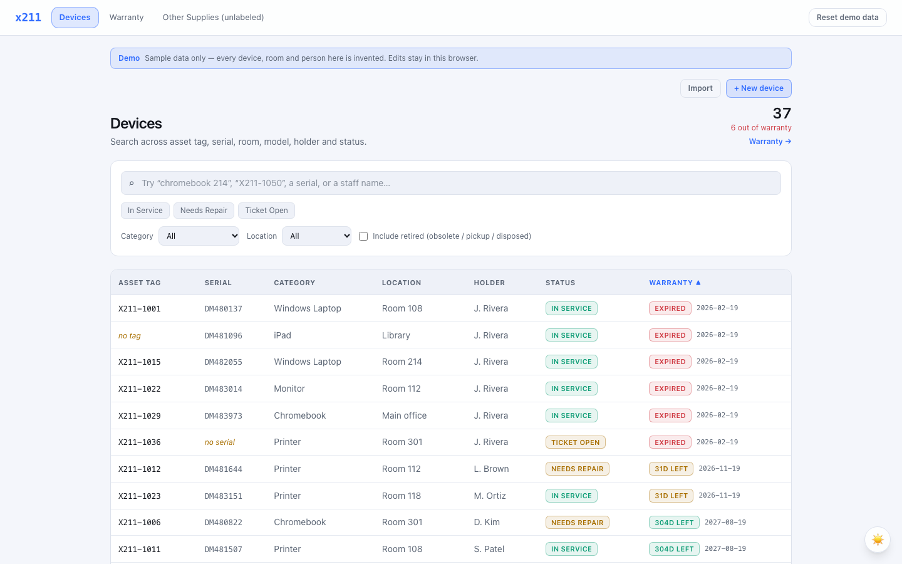

# x211 — School Device Inventory

A website to track every device at a New York City public school — laptops, Chromebooks, iPads,
monitors, printers, chargers and peripherals — with warranty tracking and an obsolete/disposal
workflow.

**See it running:** https://optimizedlp.github.io/x211/ — sample data, no sign-in.

## What it does

- Search, status/category/location filters (kept in the URL), sorting, and a warranty dashboard
  bucketed into expired / 30 / 60 / 90 days.
- Full-record editing, a new-device form with an optional camera/photo scan of the asset tag and
  serial label, and CSV/TSV import with column mapping, dry-run validation and duplicate detection.
  A duplicate asset tag is skipped, never overwritten.
- Supabase in production (Postgres + row-level security, two access codes: an **admin** that can
  write and a **guest** that can only read); browser-local storage for the demo and offline work.